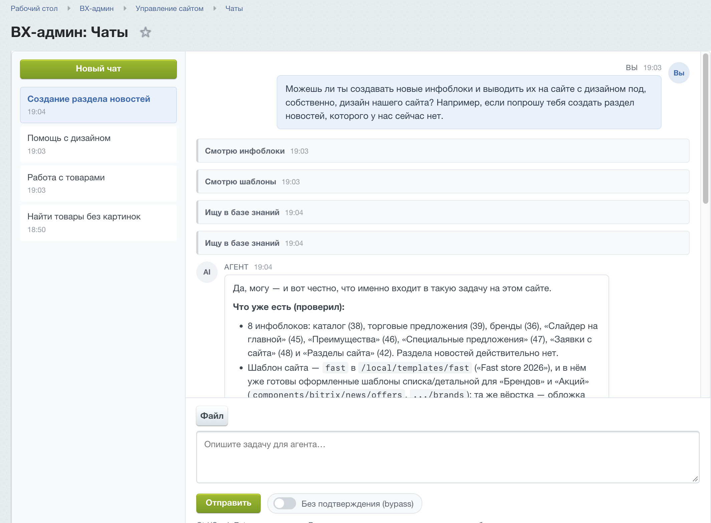
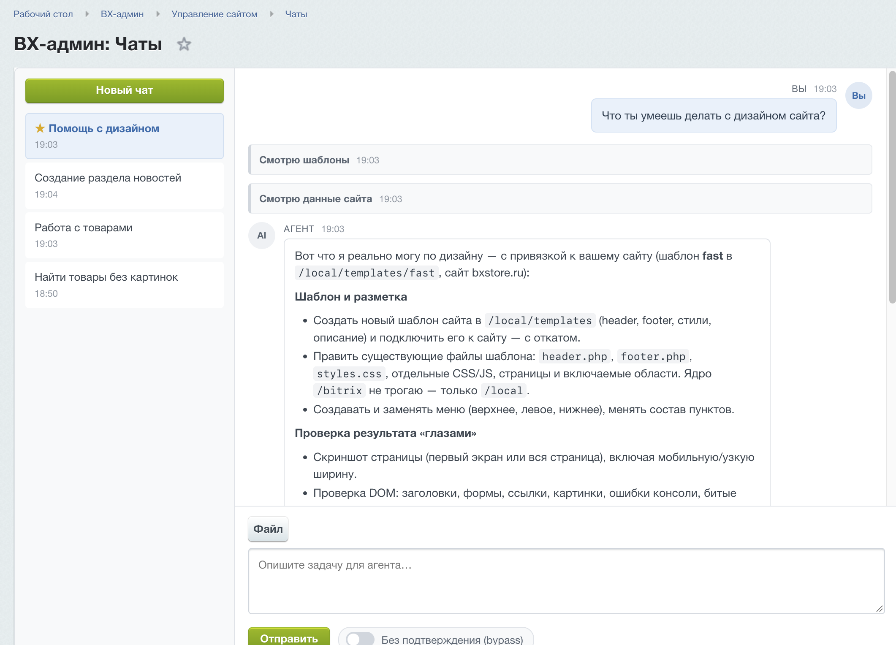
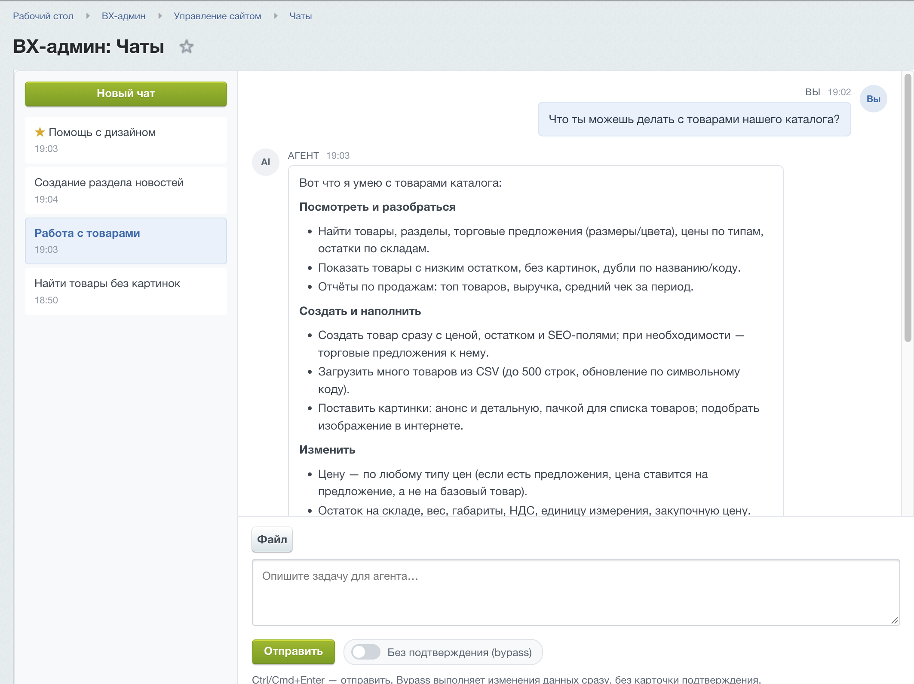

# BXADMIN-S — харнес для 1С-Битрикс (ТЗ)

> [!IMPORTANT]
> **Сначала установите сам модуль, только потом запускайте `environment/install.sh`.**
> Если environment поставить раньше модуля, MCP-серверы не зарегистрируются:
> после установки модуля выполните `./install.sh register`.
> **MCP-серверы BxMCP и Scrapling подключаются автоматически** — вручную URL,
> токены и серверы в админке вводить не нужно.

> AI-агент внутри сайта на 1С-Битрикс с полным управлением сайтом через языковую модель.
> Статус: рабочая версия 0.3.1. Документ описывает продукт; фактическое
> состояние и проверки — в `COVERAGE.md`, установка — в `setup.md`, зависимости —
> в `DEPENDENCIES.md`, окружение — в `environment/README.md`. Пункты с пометкой
> «бэклог» не реализованы.

**Название продукта — BXADMIN-S.** Модуль: `mibazarow.bxadmins`. Модуль **не привязан к
конкретному сайту**: ставится на любую инсталляцию 1С-Битрикс штатным установщиком, весь его
код живёт внутри собственной папки `local/modules/mibazarow.bxadmins/` и не требует правок
ядра, шаблонов или `local/php_interface/`. Всё, что зависит от инсталляции — список
установленных модулей, редакция, инфоблоки, сайты, настройки и права — агент определяет
на месте при установке и в работе.

**Этот документ описывает продукт в целом.** Конкретная инсталляция, на которой ведётся
разработка и отладка, указана в конце раздела как пример, а не как требование: пути, домен и
способ доставки кода на сервер у каждого свои и на возможности модуля не влияют.

**Среда разработки (пример, не требование).** Разработка ведётся прямо в проекте на
локальной копии в PhpStorm, которая автоматически выгружается по SFTP на сервер сайта;
каталоги `bitrix/` и `upload/` живут только на сервере и в синхронизацию не входят. Отдельного
репозитория/песочницы нет — код модуля и есть харнес. На другой инсталляции достаточно
скопировать папку модуля и установить его через админку.

**Жёсткое правило: `local/php_interface/` не трогаем.** Ни `init.php`, ни `agents/`,
`handlers/`, `functions/` — ничего не создаём, не правим и не подключаем. Весь код, события,
агенты, настройки, меню и управление — только внутри модуля `mibazarow.bxadmins`.

---

## 1. Суть и назначение

*Задача выполняется. Видно, что агент делает прямо сейчас, сколько шагов прошёл и сколько времени это заняло — процесс открыт, а не скрыт за «подождите».*

*Диалог с агентом: картинки и файлы можно приложить прямо в сообщение, результат приходит с превью и кнопками «Подтвердить / Отклонить / Откатить».*

*Журнал вызовов инструментов. Каждый шаг записан: что вызвано, к какому объекту, с каким итогом. Это читается как лог работы специалиста, а не как чёрный ящик.*

- **Что это.** Полноценный модуль для 1С-Битрикс — AI-агент, живущий внутри одного сайта и знающий о нём всё. По духу и возможностям — аналог Coding-агента (скиллы, инструменты, планирование, параллельные задачи), но работающий в рамках одного конкретного сайта и знающий этот сайт досконально.
- **Главная цель.** Полное и тотальное управление сайтом через языковую модель: от базы данных и инфоблоков до дизайна и шаблонов.
- **Главное отличие от «чата с нейросетью».** Агент не советует, а делает: у него есть инструменты с реальным доступом к сайту, память о проекте, откат изменений и самопроверка результата браузером. Задача заканчивается не текстом «вот как это можно сделать», а выполненной работой с отчётом.
- **Главная аудитория.** Владельцы сайтов без технических знаний. Ролевая модель заложена с самого начала, хотя в MVP работает только для администраторов.
- **Подключение к провайдеру.** К любому OpenAI-совместимому API (endpoint + токен).

---

## 2. Власть агента: домены управления

Покрытие — максимально полное, «всё, что можно и нельзя». Права выдаются **галочками** при установке и позже в настройках, по каждому домену отдельно.

**Власть определяется установленными модулями.** При установке агент получает список установленных модулей, строит по нему карту доступных инструментов и понимает, какие задачи данный проект в принципе может выполнять. В индекс попадают метаданные установленных модулей; код ядра этих модулей не индексируется.
- состав модулей зависит от **редакции** Битрикса (например, на «Старт» нет магазинных модулей — если попросят «добавь каталог товаров», агент честно скажет, что редакция не магазинная);
- учитываются и **пользовательские модули** — установленные из Marketplace и сделанные в `/local/`;
  их код из `local/modules` попадает в индекс, код ядра чужих модулей — только по чтению файлов;
- карта возможностей проекта = инструменты, доступные на данной установке; агент не обещает того, чего нет.

Ниже — полный перечень доменов, которые браузер модулей может покрывать (в конкретной установке доступна лишь часть, в зависимости от редакции и установленных модулей).

- **Ядро (main):** сайты и языки, пользователи и группы, уровни доступа, настройки модулей, почтовые шаблоны/события, короткие ссылки, капчи, пользовательские поля, рейтинги.
- **Контент:** инфоблоки (разделы/элементы/свойства/списки значений/XML-обмен), файлы и статические страницы, меню и структура, шаблоны и версии (откат), универсальные списки, HighLoad-блоки, лендинги, фотогалереи, wiki, поисковый индекс.
- **Коммерция:** заказы/корзины/оплаты/отгрузки, статусы, свойства заказа, скидки, каталог (товары, торговые предложения SKU, цены и типы цен, склады и остатки, единицы измерения, НДС), валюты и курсы, местоположения, платёжные системы, доставка.
- **Совместная работа:** соцсеть и рабочие группы, блоги, **форум (в т.ч. модерация)**, задачи и чек-листы, календарь, встречи, чаты и бот-платформа, открытые линии, почта (ящики/правила), SMS-сервисы, подписки и рассылки, опросы, идеи, обучение, sender (email-кампании), A/B-тесты, корзина удалённого, трансформер.
- **Автоматизация:** бизнес-процессы и роботы (шаблоны, запуск, задачи на утверждение), legacy-workflow, RPA.
- **Маркетинг и аналитика:** баннеры и рекламные кампании, SEO (мета, robots, sitemap, Яндекс.Директ), статистика, конверсия, отчёты и визуальный конструктор.
- **Интеграции и интерфейсы:** REST/вебхуки/OAuth, веб-сервисы, LDAP и синхронизация пользователей, соц-провайдеры, CalDAV/CardDAV, облака (S3), мобильное приложение, телефония/Voximplant, контроллер сайтов.
- **Безопасность и инфраструктура:** проактивная защита и firewall/стоп-листы, лог безопасности, бэкапы/дампы (создание, расписание, восстановление, S3), кластер и репликация БД, memcached/cache, монитор производительности, cron и агенты, очистка кеша, прямые подключения к БД, файловая система/uploads, установка/обновление модулей и маркетплейс, апдейты ядра.
- **Событийная шина:** подписка на события ядра и модулей (`OnBefore*/OnAfter*`, `OnSaleOrderSaved`, `OnBeforeIBlockElementAdd`, форум, задачи и т.д.), создание/триггер обработчиков и агентов cron.

### Примеры задач владельца

Ориентир: как харнес для компьютера тотально управляет компьютером, так этот харнес тотально управляет сайтом. Примеры ниже — иллюстрация широты, а не исчерпывающий список; принцип один — «агент может всё, что позволяют установленные модули».

**Дизайн и вёрстка**
- «Сделай все кнопки по сайту жёлтыми» → находит все кнопки на всех страницах и перекрашивает.
- «Мне не нравится, как выглядит шапка, переделай в стиле остального сайта».
- «Сделай шрифт заголовков крупнее и добавь больше воздуха между блоками».
- «Сделай так, чтобы на мобильных меню было бургером».
- «Возьми этот скрин Site X и сделай наш блок преимуществ похожим».
- «Собери новый шаблон из существующих паттернов сайта» (агент сам определяет паттерны UI/UX).

**Контент и структура**
- «Создай раздел новостей в дизайне остального сайта, наполни тестовыми новостями».
- «Добавь в каталог новую категорию "Шины" с 20 товарами из этого прайса (xlsx)».
- «Удали все устаревшие статьи старше 2023 года».
- «Перепиши текст на главной, сделай его понятнее и короче».
- «Проставь у всех товаров этих категорий страну-производителя из этой таблицы».
- «Переведи всю страницу "О компании" на английский и создай англоязычную версию».

**Коммерция и заказы**
- «Вася Пупкин на прошлой неделе заказывал шины — найди заказ».
- «Сколько я заработал за прошлый месяц? Сделай отчёт по категориям».
- «Почему упали продажи в апреле? Проанализируй и скажи».
- «Поменяй цены на всю зимнюю резину +10%».
- «Настрой бесплатную доставку при заказе от 5000 ₽».
- «Создай промокод SUMMER10 на скидку 10% для новых клиентов».
- «Верни деньги за заказ №12345 и отправь клиенту уведомление».

**Клиенты и поддержка**
- «Напомни всем клиентам, которые не покупали год, о нас».
- «Ответь на все новые обращения в техподдержку по типовым вопросам».
- «Разбери тикеты: у кого просрочен SLA — подними приоритет».

**Сообщество и модерация**
- «Модерируй форум: удаляй спам и бань спамеров автоматически».
- «Найди все сообщения о проблемах с доставкой и сделай сводку».
- «Забань всех, кто оскорбляет в комментариях».

**SEO и маркетинг**
- «Проверь все страницы на ошибки SEO и исправь (титулы, описания, ЧПУ)».
- «Собери sitemap и robots, залей в Яндекс и Google».
- «Запусти A/B-тест нового заголовка на главной и покажи результат».
- «Собери email-рассылку по базе подписчиков с новыми поступлениями».

**Инфраструктура, производительность, безопасность**
- «Сайт стал медленно открываться — найди причину и ускорь».
- «Поставь себе раз в час проверять, что сайт доступен».
- «Сделай полный бэкап и отправь его в S3».
- «Проверь сайт на вирусы и следы взлома, доложи».
- «Обнови модули и ядро, если есть обновления» (в рамках правил).
- «Найди битые ссылки по всему сайту и исправь».
- «Оптимизируй картинки — сожми без потери качества по всему сайту».

**Данные и автоматизация**
- «Проверь, нет ли дублей товаров, и объедини их».
- «Настрой бизнес-процесс: новый заказ → задача менеджеру → письмо клиенту».
- «Импортируй товары из этого XML и синхронизируй дальше по расписанию».
- «Найди клиентов с противоречивыми данными и приведи в порядок».

**Мета-примеры (агент как оператор)**
- «Что у меня сейчас происходит на сайте? Дай полный отчёт».
- «Что ты можешь улучшить на этом сайте? Предложи топ-10».
- «Проверь весь сайт и составь список проблем».
- «Мы переезжаем на новый домен — сделай всё необходимое».

Общий принцип: агент сам декомпозирует задачу, сам ищет нужные объекты по смыслу, сам планирует шаги, выполняет, проверяет и показывает результат — в пределах того, что позволяют установленные модули этой редакции.

---

## 3. Восприятие сайта (awareness)

- **Постоянная база знаний о сайте** + **живой доступ через Bitrix API** — оба подхода одновременно. Ни один не исключает другой: база отвечает «где это и как устроено», API — «что там сейчас и как это изменить».
- **Векторный RAG по индексу установки.** Сейчас индексируются: метаданные установленных
  модулей, код `local/modules` (`lib/`, `admin/`), компоненты `local/components`, шаблоны
  `local/templates`, инфоблоки и их свойства, зарегистрированные обработчики событий.
  Код ядра `bitrix/modules` и документация Битрикса в этот индекс **не входят** — для них
  нужен отдельный источник (чтение файлов или внешний MCP).
- **MVP — EmbeddingGemma 2 + MySQL/PHP:** эмбеддинги считает локальный **EmbeddingGemma 2**
  (HTTP-сервис EmbeddingGemma 2, `POST /embed`), хранятся в таблице MySQL, поиск — косинусное
  сходство на PHP. Бэкенд делаем **сменным**. Если Gemma 2 недоступна — предупреждение и
  временная деградация на MySQL FULLTEXT.
- **Headless browser** — **системный Chromium/Chrome через CDP** (на Linux работает без GUI,
   на macOS берётся установленный Chrome). Агент рендерит страницы, снимает скриншоты «до/после»,
   читает DOM и вычисленные CSS-стили, консоль и сетевые ошибки. Если браузера нет — деградация
   до HTTP/DOM/CSS с предупреждением владельцу.
- **Визуальное сравнение** — vision-модель по скриншотам и `analyze_image`; автоматический
  попиксельный дифф пока не реализован (бэклог).
- **Web scraper** — опциональный внешний Scrapling MCP: нужен только для сайтов с 403/429/
  captcha. Без него остаются встроенный Chrome и обычный HTTP.
- **Постоянный агент индексации.** При установке — полная индексация (по 20 документов за запуск,
  без пауз), после неё агент не удаляется, а переходит на инкрементальный режим: раз в 15 минут
  пересчитывает хеши, обновляет только изменившиеся документы и удаляет исчезнувшие.
  Документы режутся на фрагменты ~1500 символов — это окно модели (512 токенов): более длинный
  текст сервис молча обрезает, и хвост был бы недоступен поиску.
- Предыдущие состояния и правки: файлы — через **git**, данные — через **SQL-дампы**.

---

## 4. Автономия, подтверждения и откат

- Режим по умолчанию: **план → превью (до/после) → подтверждение → выполнение**.
- Кнопка **bypass** — действия выполняются без подтверждения.
- **Точка отката** — git-коммит всей файловой структуры (кроме `bitrix/` и `upload/`) плюс SQL-дамп БД.
  Создаётся перед каждым изменением; файлы и база возвращаются вместе.
- **Вернуть весь сайт** к состоянию перед выбранным изменением — `restore_site` (кнопка «Вернуть сайт сюда»).
  Перед откатом создаётся страховочная точка, поэтому сам откат тоже можно отменить.
  Служебные таблицы модуля (переписка, очередь, история) откат не затрагивает.
- **SQL-дамп — страховка для БД.** Перед любым изменением данных делается дамп в
  `bitrix/backup/bx_admin_s_bacaps/` с датой в имени: `bazarow_DD-MM-YYYY_HH-MM.sql.zip`
  (без секунд). Своя подпапка — чтобы не смешиваться с бэкапами пользователя из админки.
  Дампы **обязательно сжимаются в ZIP** — базы бывают большими. Это единственное разрешённое
  место записи внутри `bitrix/` — служебный каталог бэкапов, код ядра при этом не трогаем.
  По умолчанию хранится **5 последних дампов**. Более старые агент удаляет сам, если понимает,
  что откат уже не имеет смысла (слишком много потеряем); решение и причина пишутся в лог.
- История изменений в чате с кнопкой **«Откатить»**.
- При сбое посреди операции — **автооткат**: файлы к последнему хорошему коммиту, данные —
  восстановлением SQL-дампа точки отката, плюс честный отчёт.
- **Доступ к данным.** Чтение напрямую из БД разрешено для аналитики и индексации. Запись —
  только через D7 API/ORM. Если D7-способа нет — сначала легаси-метод (с обоснованием в коде),
  и только если нет и его — **прямая запись в БД как крайний случай**. Тогда агент показывает
  точный SQL и данные, которые запишет, и **требует подтверждения владельца**; без подтверждения
  запись запрещена.
- В системном промпте жёстко прописано: **максимально использовать Bitrix API**, напрямую в БД —
  только по правилу выше.

---

## 5. Проактивность

- По умолчанию — **никакой проактивности, кроме индексации всего сайта**.
- Любая проактивность задаётся владельцем **прямо в чате** («поставь себе раз в час проверять доступность сайта»). Агент сам создаёт нужное событие Битрикса или агента (cron).
- Все проактивные задачи сохраняются **в базе данных** (реестр проактивных задач).
- Через чат в любой момент можно:
  - спросить «какие у тебя сейчас проактивные задачи?» → агент вываливает их списком;
  - попросить удалить конкретную («вот эту проверку сайта удали, больше не нужна») → агент удаляет её, и проактивность исчезает.
- Бэклог: регулярные отчёты о здоровье сайта, полная инициатива «по смыслу».

---

## 6. Мультимодальность

- Вход: картинки, скриншоты, PDF/брендбуки, документы (прайс, каталог), позже — голос.
- Выход: сейчас — анализ изображений, вставка готовых картинок и превью «до/после».
  Генерация изображений (логотип, баннеры) — бэклог.
- **Возможность гейтится способностями подключённой модели:** нет vision → функция недоступна, агент честно отказывается; есть vision → обрабатывает и задаёт уточняющие вопросы.
- Пример: «скинул логотип → поставь его основным на сайте».

---

## 7. Модели

- **Несколько сохранённых подключений, активно ровно одно.** Владелец сохраняет любое число
  подключений (endpoint + ключ + модель) и переключает активное. Агент всегда работает через
  активное подключение.
- **Ассистент представляется как bxadmin и отвечает по-русски.** Вместе с сайтом, версией,
  установленными модулями, включёнными доменами, состоянием индекса, лимитами и режимом
  запуска это попадает в системный промпт — агент подстраивается под установку.
- **По умолчанию провайдер не задан.** Ни endpoint, ни модель не прописаны в поставке: пока владелец
  не внёс подключение, харнес не работает (кроме индексации базы знаний). После индексации модуль
  сам просит подключить модель и подсказывает варианты — локальный сервер (`plusvibeapi.ru`),
  свой запущенный (Ollama/LM Studio/vLLM) или облачный OpenAI-совместимый.
- **Сбой провайдера.** Если активное подключение не ответило за 60 секунд, оборвало соединение
  или вернуло ошибку уровня провайдера (нулевой баланс, отклонённый ключ, лимиты, 5xx), харнес
  предлагает в чате переключиться на другое сохранённое подключение. Если других нет — просит
  проверить провайдера. Ошибки запроса (например, превышение контекста) переключение не предлагают.
- **Хранение настроек и секретов** — в таблице подключений модуля (БД). Отдельного шифрования нет;
  доступ — только у администраторов.
- Любой провайдер — просто OpenAI-совместимый: владелец вносит endpoint и API-ключ. Отдельные нативные адаптеры (YandexGPT/GigaChat) не делаем — подключаются так же, через совместимый режим.
- **Tool calling обязателен.** Провайдер должен поддерживать function/tool calling. Если не поддерживает —
  модель не подходит для управления сайтом: harness честно сообщает это и оставляет только чат.
- **Подтягивание моделей:** при вводе endpoint модуль запрашивает у него список доступных моделей и показывает владельцу список для выбора.
- **Уровень размышлений:** пробуем получить поддерживаемые уровни у endpoint. Если он их не отдаёт
  (обычное дело для OpenAI-совместимых API) — показываем стандартный набор: «без размышлений /
  минимум / средний / максимум». Владелец выбирает один.
- **Бэклог:** авто-маршрутизация по типу задачи и требуемой способности (сейчас — ручное
  переключение активного подключения).

---

## 8. Скиллы

- Скиллы хранятся **в базе данных** (обычной строкой), а не MD-файлами.
- В системный промпт попадает **только каталог**: название, описание, теги, когда применять.
  Полные инструкции загружаются по требованию инструментом `use_skill` и остаются в истории чата.
- **Предустановленного набора скиллов в поставке сейчас нет**: список ниже — план,
  а не содержимое установки. Скиллы создаются агентом через `save_skill` или импортом `SKILL.md`.
- Владелец может **импортировать/экспортировать** `SKILL.md`, редактировать, включать,
  выключать, отправлять в корзину и восстанавливать; у каждого изменения хранится версия,
  а `use_skill` считает фактическое использование.
- Агент **сам умеет создавать скиллы** на повторяющиеся задачи (сохраняет в таблицу БД).
- Оси: **скиллы** = «что умеет», **права-галки** = «что разрешено».
- Выключенные и удалённые скиллы не попадают в каталог; включённые доступны через `use_skill`.

### Планируемый набор скиллов (в текущей версии не предустановлен)

**Критерий MVP:** скилл работает как текстовая инструкция на встроенных возможностях
(HTML/CSS/JS/PHP + Bitrix API), без Node/npm/Tailwind/Playwright и без внешних MCP-серверов.
Всё, что требует отдельного рантайма или сторонних сервисов, — в бэклог.

**Headless-браузер — не скилл, а встроенная возможность модуля** (разделы 3 и 9): системный
Chromium/Chrome через CDP. Поэтому исключение `web-scraper` из набора скиллов не лишает harness
проверки собственного сайта.

**Дизайн и UI/UX (без сборки)**
| Скилл | Что даёт |
|---|---|
| `ui-ux-pro-max` | 67 стилей, 161 палитра, шрифтовые пары, UX-гайдлайны, типы графиков |
| `design-system` | Токены (3 слоя), спецификации компонентов |
| `brand` | Голос бренда, месседжинг, консистентность айдентики |
| `prototype` | Быстрые HTML-прототипы UI и логики |
| `slides` | HTML-презентации на чистом HTML/CSS (отчёты, КП) |

**Код и разработка (только `/local/` и модуль)**
| Скилл | Что даёт |
|---|---|
| `implement` | Реализация по спецификации/тикетам |
| `implement-spec` | Реализация спецификации в коде |
| `tdd` | Разработка через тесты (red-green-refactor) |
| `code-review` | Ревью изменений: стандарты + соответствие ТЗ |
| `codebase-design` | Проектирование «глубоких» модулей, границы интерфейсов |
| `improve-codebase-architecture` | Поиск и приоритизация точек улучшения архитектуры |
| `diagnosing-bugs` | Диагностика багов и регрессий производительности |
| `domain-modeling` | Модель предметной области, CONTEXT.md, ADR |

**Контент и тексты**
| Скилл | Что даёт |
|---|---|
| `writing-fragments` | Сбор сырых набросков (идеи контента) |
| `writing-beats` | Сборка материала в структуру текста |
| `writing-shape` | Оформление в статью/абзацы (страницы, блог, рассылки) |

**Веб и данные**
| Скилл | Что даёт |
|---|---|
| `research` | Исследование по первоисточникам, отчёт в файл |

**Оркестрация и процессы**
| Скилл | Что даёт |
|---|---|
| `agent-orchestration` | Веер субагентов, изоляция, интеграция, гейты |
| `wizard` | Интерактивные визарды для владельца (онбординг, настройки) |
| `writing-for-agents` | Написание скиллов (нужно агенту для создания скиллов) |

**В бэклог MVP** (нужен внешний рантайм или сторонние сервисы): `ui-styling` (Tailwind/Radix),
`figma-fig` (npm-парсер `.fig`), `design` и `banner-design` (генерация изображений через внешние
модели), `web-scraper` (Playwright), `resolving-merge-conflicts`
(git-ветки), `handoff` и `claude-handoff` (инфраструктура агента, не продукта).

**В поставку не берём** (методология самого Coding-агента, TS-специфика или инфраструктура Kilo): `ask-matt`, `grilling`/`grill-me`/`grill-with-docs`, `loop-me`, `wait-what`, `teach`, `to-questionnaire`, `to-spec`, `to-tickets`, `triage`, `wayfinder`, `kilo-config`, `migrate-to-shoehorn`, `setup-ts-deep-modules`, `scaffold-exercises`, `setup-matt-pocock-skills`, `git-guardrails-claude-code`, `setup-pre-commit`.

Перечень наполняется итеративно; в текущей версии он не предустановлен.

---

## 9. Проверка работы и показ результата

- Агент **самопроверяется** через системный headless-браузер (Chromium/Chrome, CDP):
  - рендерит затронутые страницы и снимает скриншоты «до/после»;
  - сравнивает визуально через vision-модель; попиксельный дифф — бэклог;
  - проверяет DOM и вычисленные CSS: элементы на месте, размеры, цвета, отступы;
  - проверяет консоль на ошибки и неудачные сетевые запросы;
  - прогоняет дымовые тесты: страница открывается, ошибок нет, формы и ссылки работают.
- Показывает **план/дифф** до применения и просит подтверждения (кроме bypass).
- На выходе — **человеческим языком**: «что сделал, где, как проверить, как откатить».
- Кнопки **«Подтвердить / Отклонить / Откатить»** прямо в чате.

---

## 10. Роли и доступ

- **MVP:** харнес доступен **только администраторам**.
- Каждый пользователь — **своя история чатов и сессий**; база знаний о сайте — общая на инсталляцию.
- **Бэклог:** доступ по группам Битрикса с урезанным набором доменов; агент действует в рамках эффективных прав вызвавшего его пользователя.

---

## 11. Долгие задачи и параллельность

- Агент работает **асинхронно в фоне**; в чате виден прогресс, можно продолжать другие задачи.
- Цикл «LLM → инструмент → LLM» выполняет **Node-демон**; PHP исполняет инструменты короткими
  запросами. Ответ модели **стримится** в браузер через встроенный SSE-поток по мере генерации.
- Демон **сторожится агентом Битрикса** (раз в минуту): упавший процесс поднимается сам,
  без systemd и root.
- Умеет выполнять **несколько задач параллельно**: воркеры демона берут задачи из разных чатов
  (до `worker_concurrency`, по умолчанию 10); в одном чате задачи идут очередью.
- Отдельных под-агентов и «роя» в текущей версии нет — это бэклог.
- **Изоляция от конфликтов:** параллельные задачи не должны одновременно менять один и тот же
  файл; конфликты разводятся по файлам/объектам на уровне инструментов и снапшотов.
- Фоновое выполнение через **агентов/cron Битрикса** — задача доживает без открытого браузера.
- **Уведомление по завершении** (в чате; позже — email/мессенджер).

### Обработка ошибок и восстановление
- При сбоях LLM/API — **2–3 ретрая** с бэкоффом.
- Если после ретраев не получилось — **откат файлов к ближайшему (последнему хорошему)
  git-коммиту**, данных — **восстановлением последнего SQL-дампа** из
  `bitrix/backup/bx_admin_s_bacaps/`.
- Владельцу — **понятное объяснение**, что пошло не так (человеческим языком), плюс что можно сделать.
- Для длинных задач (индексация/обход) — чекпойнты для возобновления с последнего завершённого шага (не с нуля).
- **Логи.** По умолчанию хранятся **только ошибки, 15 дней**. Срок меняется в настройках;
  `0` — логирование полностью выключено.

---

## 12. Мультисайт и язык интерфейса

- **MVP:** модуль видит все сайты инсталляции через инструменты (`list_sites`, `get_site`,
  `update_site`, `create_site`), но база знаний, настройки и галки-права **общие на установку**.
  Разделение по сайтам — бэклог.
- Язык интерфейса — **русский**; архитектурно закладываем переводы.
- **Бэклог:** управление мультисайтом как единым организмом.

---

## 13. Совместимость

- Установка — штатным установщиком Битрикса (`install/index.php`).
- Ядро D7; **PHP 8.1–8.5**. Функционал агента = установленные модули.
- Для визуальной проверки — **системный Chromium/Chrome** (headless, через CDP). Без него harness
  работает, но дизайн проверяет только по DOM/CSS и предупреждает об ограничении.
- **EmbeddingGemma 2** — локальный HTTP-сервис на сервере (`127.0.0.1:8000`, модель
  `google/embeddinggemma-2`, dim 256) — нужен для векторного поиска в MVP. Модуль обращается
  к нему через `POST /embed` с профилями `site_passage` (индексация) и `site_query` (поиск).
  Если сервис недоступен — временный FULLTEXT-режим с предупреждением.
- **Эталонная инсталляция для отладки** — Linux-сервер без GUI (Apache + nginx, Rocky Linux),
  поэтому системный Chromium, EmbeddingGemma 2 и cron настраивались и проверялись там. Это
  пример, а не требование: модуль рассчитан на любую инсталляцию Битрикса с PHP 8.1–8.5,
  а встроенные средства (`environment/install.sh`) поддерживают Debian/Ubuntu и RHEL-совместимые системы.
- **Развёртывание на новом сайте — `setup.md`.** Там по шагам: требования, cron Битрикса,
  Node-демон, каталог данных вне docroot, headless-браузер, сервис эмбеддингов, права на файлы,
  настройки после установки, SSE-доставка, проверка работоспособности, обновление и частые проблемы.
- **Окружение — `environment/`.** `install.sh` на Debian/Ubuntu и RHEL-совместимых
  проверяет/доустанавливает системные пакеты (`git`, mysql-клиент, cron, библиотеки Chrome),
  ставит Node, BxMCP, EmbeddingGemma 2 (веса уже в `environment/models`), Scrapling
  и Chrome, настраивает systemd/cron. Документация BxMCP тоже входит в `environment`.
  Индекс BxMCP строится на месте, а не поставляется готовым. `--payload` — офлайн-режим,
  `bundle.sh` — упаковка уже установленного окружения.

---

## 14. Онбординг (первичная индексация)

- При первой установке — честно предупреждаем владельца, что запускается **глубокая индексация** (может занять время, зависит от размера сайта).
- В онбординге — проверка **EmbeddingGemma 2**: если доступен, используем его для эмбеддингов;
  если нет — показываем инструкцию по установке и временно работаем на MySQL FULLTEXT.
  Хранение и поиск — MySQL + PHP в обоих случаях.
- Пока глубокая индексация не завершена, **харнес полностью заблокирован**.
- После индексации — **шаг подключения модели**: если endpoint и модель ещё не заданы, вместо чата
  показывается экран «Подключите языковую модель» с тремя подсказками (локальный сервер, свой
  запущенный, облачный OpenAI-совместимый) и переходом в настройки. Без подключения модуль не работает.
- Вместо интерфейса показываем **красивое оповещение**: «Идёт полная индексация сайта, подождите.
  Время зависит от вашего сервера и объёма сайта». Рядом — прогресс-бар или симпатичный индикатор
  (точный процент не обязателен, можно бесконечную «волну»/крутилку) и короткое объяснение,
  зачем нужна индексация: без неё агент не знает сайт и не может им управлять.
- Индексация идёт **в фоне** и продолжается, даже если владелец закрыл браузер.

---

## 15. Приватность и данные

- **MVP: маскирование персональных данных не реализуем.** Это отдельный этап после того, как
  основная функциональность будет готова.
- Пока — честное предупреждение: запросы и данные уходят выбранному провайдеру; ответственность
  за ПДн и соблюдение закона — на владельце.
- В настройках можно указать **свою LLM** (Ollama / свой сервер) — тогда данные не уходят в облако.
- **Лицензионное соглашение** с предупреждениями обо всём.
- **Бэклог:** детерминированные детекторы ПДн (email, телефон, ФИО, адрес, паспорт, платёжные
  данные), замена плейсхолдерами, локальная таблица соответствий, режим «только агрегаты»,
  журнал отправленных провайдеру запросов.

---

## 16. Чат и рабочий стол (UX)

Обязательные элементы:
- **Видимый план/чек-лист** по задаче, обновляемый по ходу.
- **Вложения** — картинка/файл/URL прямо в сообщение.
- **Якорение контекста** — частично: ссылка или скриншот в сообщении. Отдельный выбор
  элемента/«вот эта кнопка» — бэклог.
- **Встроенные превью** — диффы кода, скриншоты до/после, кнопки «Подтвердить / Отклонить / Откатить».
- **Поиск по истории** всех чатов — бэклог.
- **Контекст проекта** — через память и скиллы; отдельного «закреплённого» блока нет (бэклог).
- Несколько сессий: создание, история, переключение, продолжение беседы.

Требование к UX: **дружелюбно, отполировано, без оверинжиниринга и овердизайна**, но с полным функционалом — чтобы среднестатистический человек разобрался сходу.

### Раздел в глобальном меню админки

- В **глобальном меню** админки Битрикса появляется раздел **BXADMIN-S** — по названию модуля.
- Иконка на MVP — временная заглушка (любая стандартная); позже заменим на фирменную.
- Внутри раздела — подразделы:
  - **Чаты** — рабочий стол, история сессий, вложения.
  - **Настройки** — провайдер (endpoint + токен), модель и уровень размышлений, скиллы,
    права-галочки по доменам, сторонние MCP-серверы.
  - **Задачи** — задачи по расписанию: что агент делает сам, как часто и с каким результатом.
  - **Обслуживание** — индексация базы знаний, история изменений, бэкапы, логи.
- Пункты меню и страницы создаются **штатными средствами модуля** (`admin/`, `install/`,
  `lib/Controller/`). Никаких файлов в `local/php_interface/` для этого не создаётся.

---

## 17. Встроенные инструменты и MCP

- **Это не MCP-сервер внутри модуля.** Основная поверхность — собственный `ToolRegistry`
  с **205 встроенными инструментами** (на версии 0.3.1). Инструменты описаны классами
  в `lib/Tool`, доступность фильтруется доменами прав, а наличие нужного модуля
  проверяется при вызове.
- **Индекс установки** (`IndexService`) индексирует метаданные установленных модулей,
  код `local/modules`, компоненты `local/components`, шаблоны `local/templates`,
  инфоблоки и свойства, зарегистрированные обработчики событий. Код ядра
  `bitrix/modules` и документация Битрикса в индекс не входят; код ядра читается
  по требованию через `read_file`/`run_php`.
- **Что есть встроено:** управление сайтами, модулями (список, установка/удаление,
  свои модули), пользователями и группами, инфоблоками/элементами/свойствами,
  HighLoad-блоками, каталогом/ценами/остатками, заказами/скидками/промокодами,
  платёжными системами/доставкой, форумом/блогом/календарём, SEO, файлами сайта
  и `local/`, меню, редиректами, robots, почтовыми шаблонами, опциями модулей,
  бэкапами, кешем, агентами, расписаниями, памятью, скиллами, `run_sql` (только
  чтение), `run_php`, `search_knowledge`, `analyze_image`.
- **Инструменты не генерируются динамически из модулей.** Набор фиксирован в коде;
  редакция и состав модулей влияют на то, что реально доступно, а отсутствующий модуль
  даёт понятную ошибку инструмента.
- **MCP — это внешние серверы.** В настройках добавляется сервер (URL, токен), модуль
  запрашивает его инструменты. Схемы не грузятся в каждый запрос: агент получает
  каталог и работает через `mcp_tool` (list → describe → call). Транспорт —
  Streamable HTTP (JSON и `text/event-stream`). `environment/install.sh` ставит
  BxMCP и Scrapling и регистрирует их автоматически — пользователю не нужно
  подключать их вручную.
- На этом сервере подключены два необязательных сервера:
  - BxMCP LiveAPI (`127.0.0.1:3100`, 24 инструмента): код ядра, функции/классы,
    события, документация, поиск использований. Сервер, документация и модель
    эмбеддингов входят в `environment/`; индекс строится на месте;
  - Scrapling (`127.0.0.1:3101`, 16 инструментов): обход 403/429/captcha и сложный
    парсинг. Без него работают встроенный Chrome и обычный HTTP.
- **Без MCP модуль работоспособен.** Встроенные 205 инструментов и RAG по установке
  остаются; пропадают только справочник по коду ядра/документации и обход защищённых
  сайтов.
- **Бэклог:** харнес сам выступает MCP-сервером наружу; REST/вебхук-API для внешних клиентов.

---

## 18. Жёсткие запреты (действуют всегда, даже в bypass)

- **Файлы ядра `/bitrix/` руками не правим** — табу. Штатные обновления ядра и модулей через
  updater/маркетплейс разрешены: только с подтверждением и предварительным бэкапом. Всё
  остальное — в `/local/` и свои модули.
- **`local/php_interface/` не трогаем вообще** — ни `init.php`, ни `agents/`, `handlers/`,
  `functions/`. Вся логика, события, агенты, настройки и меню — только внутри модуля.
- Необратимые операции без снапшота (удаление/дроп, массовые удаления).
- Прямая запись в БД без показа точного SQL и подтверждения владельца.
- Реальные денежные операции (списания, возвраты, платежи).
- Отключение бэкапов и безопасности.
- Массовые рассылки реальным клиентам.
- Пуш в удалённый git.
- Удаление чужих файлов за пределами сайта.

Список будет дополняться по ходу.

---

## 19. Бэклог (после MVP)

- Виджет на самом сайте в режиме владельца (ткнуть в элемент и поправить).
- Управление через мессенджеры (Telegram/WhatsApp) и почту.
- Мобильное приложение; десктопное приложение; голосовой ввод (в мобильном).
- Мультипровайдер и авто-маршрутизация моделей.
- Разграничение прав по группам пользователей Битрикса.
- Харнес как MCP-сервер наружу + REST/вебхук-API.
- Управление мультисайтом как единым организмом.
- Регулярные проактивные отчёты о здоровье сайта; инициатива «по смыслу».
- ~~`setup.md` — инструкция для владельца/админа сервера~~ — **сделано**, файл лежит рядом
  с этим README: требования, cron, демон, каталог данных, браузер, эмбеддинги, права,
  настройки после установки, SSE-доставка, проверка, обновление, частые проблемы.

---

## 20. Открытые вопросы

Все открытые вопросы первого прохода закрыты. Новые будут появляться по ходу вычитки и дополировки ТЗ.
